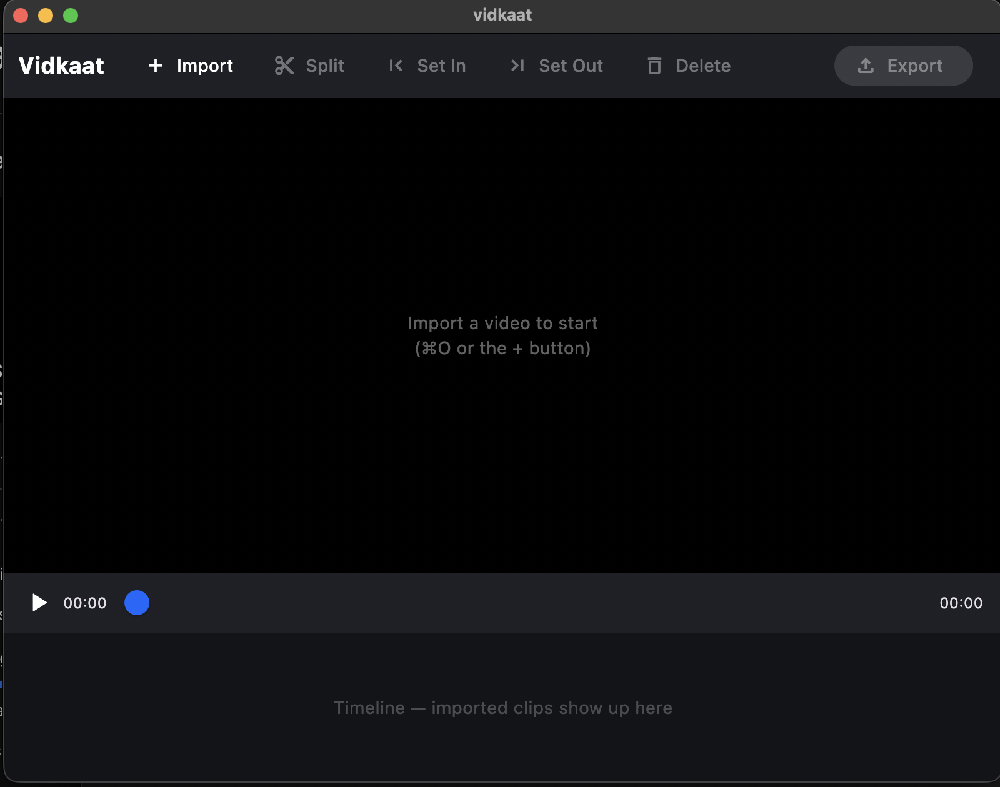

<div align="center">

# ✂️ Vidkaat

### The free, open-source CapCut alternative — on your desktop.

No subscription. No watermark. No account. No upload. Ever.



<p>
  <a href="#"></a>
  <a href="#"></a>
  <a href="#"></a>
  <a href="#"></a>
  <a href="#"></a>
</p>

</div>

---

## About

**Vidkaat** is a free, open-source video editor for desktop — a CapCut alternative
that does the things people actually open an editor for: cut, trim, split, join
clips, and export clean video. No subscription wall, no watermark baked into your
export, no account, and nothing is ever uploaded. Your footage stays on your disk.

It's built with **Flutter** for a fast, native desktop app, with **FFmpeg** doing
the heavy video work under the hood. macOS first, Windows and Linux next — one
codebase, same app everywhere.

> **Early days.** This is `v0.1`: the solid core — import, preview, cut, trim,
> split, export. The architecture is deliberately built so new features (captions,
> effects, titles, transitions) can land fast. [Contributions welcome](#contributing).

## ✨ Features

- 🗂️ **Project launcher** — create, save and reopen projects from a recent-projects grid with poster thumbnails (like CapCut / DaVinci)
- 🎛️ **Pro editor layout** — media bin, centre monitor, inspector and timeline, the classic NLE arrangement (modelled on Concat)
- 🎬 **Import** video files — mp4, mov, mkv, webm, avi, m4v
- ▶️ **Preview** with play / pause / frame-accurate scrubbing
- ✂️ **Split** a clip at the playhead
- ⬅️➡️ **Trim** — set in / out points precisely
- 🧲 **Timeline** of clips, sized by duration
- 📤 **Export** the whole timeline to one MP4 (H.264 + AAC)
- 🔒 **100% local** — no account, no upload, works offline
- 🚫 **No watermark, no subscription** — truly free

## 🧱 How it's built

Layered, feature-first architecture (the Flutter-recommended `data` / `domain` /
`ui` split), with MVVM view-models powered by Riverpod (codegen):

```
lib/
├── domain/models/          → Clip, Project, VideoSettings (plain data)
├── data/
│   ├── engine/             → Engine interface + FfmpegEngine (the heavy work)
│   └── project/            → ProjectStore (project folders, recents)
└── ui/
    ├── core/               → theme, colours, spacing tokens, shared widgets
    └── features/
        ├── launcher/{views, view_models}   → start screen, new-project dialog
        └── editor/{views, view_models}     → preview, timeline, toolbar
```

The golden rule: **the UI and the engine are separate.** `Engine` is a small
interface; `FfmpegEngine` is the only implementation today, shelling out to the
system `ffmpeg`. The day real-time GPU effect preview is needed, a native (e.g.
Rust) engine can implement the **same interface** — and not a line of UI changes.

> Uses `riverpod_generator`, so run `dart run build_runner build` after changing
> an annotated provider.

## 🚀 Getting started

### Requirements

- [Flutter](https://flutter.dev) with desktop enabled
- `ffmpeg` and `ffprobe` on your `PATH`
  - **macOS:** `brew install ffmpeg`
  - **Windows / Linux:** install FFmpeg and make sure it's on PATH

### Run it

```sh
git clone https://github.com/nobaab/vidkaat.git
cd vidkaat
flutter pub get
flutter run -d macos   # or -d windows / -d linux
```

### Test it

```sh
flutter test                      # unit + widget tests
flutter test --tags integration   # real ffmpeg end-to-end tests
```

## 🗺️ Roadmap

- [x] Project launcher: new project, recent-projects grid, open/save `vidkaat.json`
- [ ] Project launcher extras: templates row, grid/list toggle, sort, rename/duplicate
- [ ] Full timeline-sequence preview (not just one clip at a time)
- [ ] Drag to reorder / trim clips directly on the timeline
- [ ] Auto-captions (local Whisper)
- [ ] Text & titles, filters, transitions
- [ ] Proxy (low-res) preview for smooth 4K scrubbing
- [ ] Bundle FFmpeg + signed installers for macOS / Windows / Linux
- [ ] Native GPU engine behind the same `Engine` interface

## 🤝 Contributing

PRs, ideas and bug reports are all welcome — this project exists to be hacked on.
Fork it, try a feature, open a PR. For anything bigger, open an issue first so we
can talk it through.

## 📄 License

[MIT](LICENSE) — do whatever you want with it. Use it, fork it, ship it.

---

<div align="center">
<sub>Built in the open. If Vidkaat saves you a CapCut subscription, drop a ⭐.</sub>
</div>
